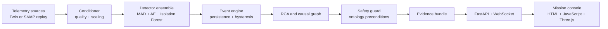

# AEGIS

## Team project | Team Quibits | Runner-up

AEGIS is a real-time spacecraft telemetry health-monitoring and decision-support
platform. It combines a synthetic spacecraft digital twin, telemetry replay,
stream conditioning, anomaly detection, explainable root-cause analysis, a
deterministic safety guard, and a browser-based mission console.

This repository represents a **team project**. It is not a claim that every
file or component was written by one contributor. AI coding agents were used as
development assistants; the team's engineering work included shaping the
problem, selecting the architecture, integrating the modules, validating the
system, and preparing the demonstration.

## Why AEGIS?

Spacecraft telemetry is noisy, multivariate, and vulnerable to missing, stale,
delayed, out-of-order, or implausible measurements. A useful monitoring system
must distinguish a spacecraft fault from a sensor/link fault, explain the
evidence, and avoid unsafe action when the data is not trustworthy.

AEGIS turns telemetry into:

1. Quality flags and robustly scaled values.
2. Complementary anomaly scores.
3. Persistent event records with channel attribution.
4. Ranked fault causes and causal links.
5. Safety-checked action proposals.
6. Live evidence for operators and downstream tools.

## At a glance

| Capability | Implementation |
|---|---|
| Streaming backend | FastAPI + WebSocket |
| Detection | MAD + NumPy autoencoder + Isolation Forest |
| Explainability | Fault signatures + lagged causal links |
| Safety | YAML action ontology + deterministic guard |
| Visualization | Browser console + Three.js spacecraft view |
| Evaluation | Twin, data-fault, SMAP replay, and edge parity benchmarks |

## Architecture

```text
TwinSource / FileSource
        |
        v
TelemetryFrame (event time + arrival time)
        |
        v
Conditioner -> QualityFlags + scaled vectors
        |
        v
MAD + NumPy Autoencoder + Isolation Forest
        |
        v
Ensemble -> EventEngine
        |
        v
AnomalyEvent -> RCA + lagged causal graph
        |
        v
Safety Guard + YAML action ontology
        |
        v
EvidenceBundle -> REST / WebSocket / mission console
```



For a file-by-file architecture guide, see
[`docs/ARCHITECTURE.md`](docs/ARCHITECTURE.md).

### Main modules

| Area | Location | Responsibility |
|---|---|---|
| API application | [`api/app.py`](api/app.py) | FastAPI application construction |
| API configuration | [`api/settings.py`](api/settings.py) | Seed, data directory, host/port, provider key settings |
| API and runtime lifecycle | [`api/server.py`](api/server.py) | REST routes and engine startup/tick lifecycle |
| WebSocket stream | [`api/websocket.py`](api/websocket.py) | Telemetry subscription and status messages |
| External feed adapters | [`api/feeds.py`](api/feeds.py) | JSON/text HTTP access for public feeds |
| Optional AI provider | [`api/ai_provider.py`](api/ai_provider.py) | OpenAI-compatible explanation calls and fallback narrative |
| Browser console | [`api/static/`](api/static/) | Mission UI and Three.js visualization |
| Contracts | [`contracts/models.py`](contracts/models.py) | Dataclass interfaces and telemetry taxonomy |
| Sources | [`sources.py`](sources.py) | Digital-twin, bus, replay, and overlay sources |
| Conditioning | [`conditioner/stream.py`](conditioner/stream.py) | Scaling and data-quality assessment |
| Detectors | [`detectors/`](detectors/) | MAD, autoencoder, Isolation Forest, events |
| Runtime orchestration | [`runtime/engine.py`](runtime/engine.py) | Streaming pipeline and evidence assembly |
| Reasoning | [`reasoning/`](reasoning/) | RCA, causal links, ontology, safety guard |
| Digital twin | [`twin/spacecraft.py`](twin/spacecraft.py) | Physics-shaped spacecraft simulation and faults |
| Evaluation | [`evalharness/`](evalharness/) | Benchmarks and event metrics |
| Edge export | [`export/edge_bundle.py`](export/edge_bundle.py) | NumPy bundle and ground/edge parity |
| Domain knowledge | [`ontology/`](ontology/) | Fault signatures and vetted actions |

## Technology stack

- Python
- FastAPI and Uvicorn
- WebSockets
- NumPy
- scikit-learn Isolation Forest
- Custom NumPy MLP autoencoder
- PyYAML
- Optional SGP4 satellite propagation
- HTML, CSS, JavaScript, and Three.js
- JSON, JSONL, YAML, CSV, NPY, and NPZ data formats

## Repository layout

```text
AEGIS/
├── api/              FastAPI service and static mission console
├── conditioner/      Streaming conditioning and quality flags
├── contracts/        Internal dataclass contracts
├── data/             Telemetry, labels, benchmark and edge artifacts
├── detectors/        Anomaly models and event engine
├── evalharness/      Benchmark runners and metrics
├── export/           Edge bundle export and parity checks
├── ontology/         Fault graph and action library
├── reasoning/        RCA, causal links and safety validation
├── runtime/          Main streaming engine
├── tools/            Refresh and robustness utilities
├── twin/             Spacecraft digital twin
├── sources.py        Input source adapters
├── requirements.txt  Runtime dependencies
└── README.md         Project documentation
```

Generated files such as Python caches, local environments, OS metadata, and
logs are excluded by [`.gitignore`](.gitignore).

## Setup

The project is a Python package directory named `AEGIS`. Clone it, then run
commands from the directory containing that package:

```powershell
git clone https://github.com/rakeshbhakre/AEGIS.git
cd AEGIS
python -m venv .venv
.\.venv\Scripts\Activate.ps1
python -m pip install --upgrade pip
python -m pip install -r requirements.txt
```

On macOS/Linux, activate the environment with:

```bash
source .venv/bin/activate
```

## Run the mission console

From the directory **above** the cloned `AEGIS` package:

```powershell
python -m uvicorn AEGIS.api.server:app --host 127.0.0.1 --port 8890
```

Open <http://127.0.0.1:8890/>.

Runtime settings can be supplied through environment variables: `AEGIS_SEED`
(default `7`), `AEGIS_DATA_DIR` (default `AEGIS/data`), `AEGIS_HOST` (default
`127.0.0.1`), and `AEGIS_PORT` (default `8890`). Optional explanation providers
read `OPENROUTER_API_KEY` and `OMNIROUTE_API_KEY` from the environment. The
server also exposes `GET /api/health`, which reports process health and whether
startup warming is still in progress; `/api/live` retains its existing warming
payload.

The server warms the engine on startup. The console can switch between the
synthetic twin and SMAP replay, inject health/data faults, adjust link quality,
label events, retrain the autoencoder, and inspect live evidence.
To use `AEGIS_HOST` and `AEGIS_PORT`, run `python -m AEGIS.api` from the same
parent directory instead of passing Uvicorn's host and port flags directly.

## Run the benchmark harness

From the directory above the package:

```powershell
python -m AEGIS.evalharness.run_bench --help
```

The saved benchmark artifacts are [`data/bench.json`](data/bench.json) and
[`data/edge_report.json`](data/edge_report.json). They are workload-specific
evidence, not universal accuracy or latency guarantees.

## API surface

### Read endpoints

`GET /api/live`, `/api/state`, `/api/events`, `/api/quality`, `/api/bench`,
`/api/fleet`, `/api/passes`, `/api/ai/status`, `/api/crew`, and `/api/sky`.

### Control endpoints

`POST /api/quality`, `/api/inject`, `/api/inject_data`, `/api/storm`,
`/api/dial`, `/api/labels`, `/api/refresh`, `/api/train`, `/api/speed`,
`/api/replay_file`, `/api/twin_mode`, and `/api/ai/explain`.

The live stream is available at `WS /ws`.

## Screenshots and demo

The browser console is implemented in
[`api/static/index.html`](api/static/index.html) and
[`api/static/craft.js`](api/static/craft.js). It includes live telemetry,
event/evidence views, controls, and a 3D spacecraft visualization.

No screenshot assets are committed yet. To capture a reproducible screenshot:

1. Start the server using the command above.
2. Open `http://127.0.0.1:8890/`.
3. Wait for the engine to finish warming.
4. Inject a demo fault from the console.
5. Capture the live telemetry, anomaly, RCA, and action panels.

## Current validation evidence

The saved benchmark reports:

- 40 synthetic fault episodes and 29 detections.
- 1.044 unmatched false positives per day in the saved twin run.
- 28 data-fault injections with a 92.9% rejection rate.
- Edge bundle size of 601,187 bytes.
- Ground/edge maximum relative difference of 0.0 in the saved parity run.
- SMAP saved-run event recall of 0.0; this is a known limitation and must not
  be presented as production-ready real-telemetry accuracy.

## Security and deployment note

This is a demonstration and research project intended for a trusted/local
environment. The repository does not currently provide authentication,
authorization, TLS termination, rate limiting, or durable audit storage.
Do not expose the control endpoints to the public Internet without adding
those controls. Keep provider keys in environment variables and never commit
`.env` files or credentials.

## Attribution and responsible claims

AEGIS is a team-built project delivered with AI-assisted development. Public
descriptions should distinguish:

- **Team capability:** the complete architecture and feature set in this repo.
- **Individual contribution:** only the modules, decisions, integration,
  validation, documentation, and presentation work personally owned by that
  contributor.

The project demonstrates applied Python, real-time systems, anomaly detection,
explainable reasoning, browser visualization, benchmarking, and edge inference.
It should not be described as a flight-qualified autonomous spacecraft system.

## License and third-party data

Review the licenses and attribution requirements for the embedded Telemanom
dataset and vendor assets before redistributing the repository. The historical
dataset source documentation is under
[`data/telemanom-dataset-master/`](data/telemanom-dataset-master/).
